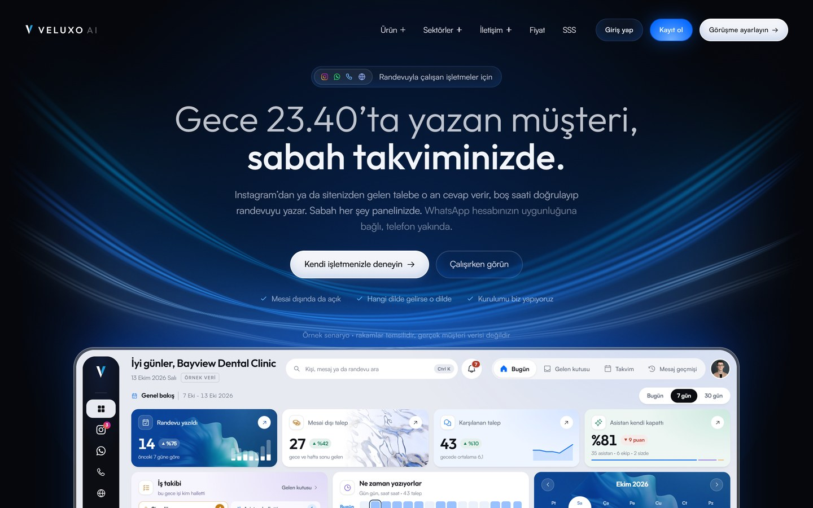
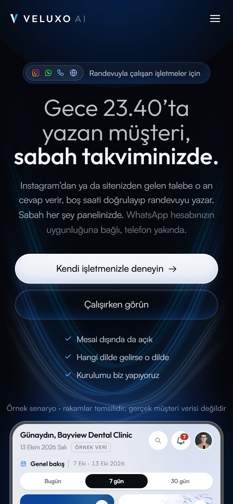

## Kerem Aydın

Mathematics student at Sakarya University. I design and build **websites,
dashboards, AI agents and automations**, and the checks that prove they still
work tomorrow. I run a one-person company where most of the staff are agents.

**Open for freelance work:** websites · admin panels and dashboards · workflow
automation (n8n, Make, Telegram bots, AI agents).

---

### Product

**[Veluxo AI](https://veluxoai.com)** · live, built alone

A written-channel receptionist for appointment-based businesses. A message
arrives on Instagram or WhatsApp, the assistant answers it, checks a real free
slot, and writes the booking into the business's own panel. Now extended for
real-estate offices: every customer request is kept and matched to new listings.

- Designed and built end to end: marketing site, onboarding, multi-tenant
  business panel (inbox, calendar, conversation history).
- Instagram DM and WhatsApp Cloud API behind one signature-checked webhook.
- A booking engine that writes only after the slot is confirmed free.
- A voice agent prototype that answers the phone and books into the same calendar.
- 340+ automated tests · 670+ commits since July 2026.
- Next.js · React · TypeScript · Supabase (Postgres) · OpenAI · Vercel.

  
  

Site and panel designed and built by me. The panel shown on the home page uses sample data.

### Systems I run for myself

Private code, real use. About 1,400 commits across my private repositories in the last year.

| System | What it does |
|---|---|
| **Cockpit** | One dashboard for everything below. Each automation is drawn as a flow diagram that lights up step by step while it runs. |
| **Telegram team** | Bots that send a short morning plan, ask for decisions with buttons and report when something breaks. |
| **Night watch** | Opens the live site every night as a phone and a desktop and reports what broke without an error. Open-sourced as [gece-bekcisi](https://github.com/kerem-aydin/gece-bekcisi). |
| **Research lines** | Coding agents read public sources in five audited stages to find problems people actually pay for. Method open-sourced as [kanitli-arastirma](https://github.com/kerem-aydin/kanitli-arastirma). |
| **Problem radar** | Collects public complaints and reviews, clusters them, counts distinct people. |
| **Job hunter** | Finds small paid automation jobs on public boards and scores them with explicit rules, no model. |
| **Weekly report** | Every Sunday, what was actually built that week, from GitHub and the task list. |
| **Usage guard** | Keeps background agents within limits so the owner always has room to work. Part of [ajan-ofisi](https://github.com/kerem-aydin/ajan-ofisi). |

### Design

I design what I build: the Veluxo site and panel, the cockpit, and a browser
driving game with a procedural, seed-based world and engine sound synthesized
with the Web Audio API (three.js).

### Open source

| Repository | What it does |
|---|---|
| **[gece-bekcisi](https://github.com/kerem-aydin/gece-bekcisi)** | Night watch for websites. A real browser scrolls every page as a slow phone and a desktop, reports invisible sections, sideways scroll, broken images, slow pages. Proves itself first by catching a bug put back on purpose. |
| **[kanitli-arastirma](https://github.com/kerem-aydin/kanitli-arastirma)** | Evidence-first research run by coding agents: separate stages, an adversarial audit by an agent that did not write the work, code-checked rules for what counts as proof that people pay. |
| **[ajan-ofisi](https://github.com/kerem-aydin/ajan-ofisi)** | A one-person office on Telegram: morning plan from a Markdown task list, a decision box with buttons, a usage guard for background agents. |
| **[randevu-widget](https://github.com/kerem-aydin/randevu-widget)** | A booking widget for any site with one script tag. Shadow DOM, slots in the business's own time zone. [Live demo](https://kerem-aydin.github.io/randevu-widget/demo/) |
| **[tr-dogrulama](https://github.com/kerem-aydin/tr-dogrulama)** | Validation for Turkish business data: phone numbers, national ID, tax number, IBAN, role vs. personal email. |

All tested on every push, none with more than one dependency.

### How I work

- **A model's output is a claim.** "Your appointment is confirmed" is sent only after the calendar has accepted it.
- **Measure what the user sees.** My site's footer was blank on phones with every test green. The night watch exists because of that.
- **Proof before building.** A complaint count is not proof that anyone pays; my research rules say what is.

### Now · October 2026

- Open for freelance automation, website and dashboard work.
- Taking Veluxo to real-estate offices.
- Six research lines (three finished) on where AI solves problems people pay for.

TypeScript · JavaScript · Python · Next.js · React · Node.js · Supabase / Postgres ·
Meta Graph API · OpenAI · n8n · Make · GitHub Actions · Vercel · Puppeteer · three.js

[veluxoai.com](https://veluxoai.com) · [LinkedIn](https://www.linkedin.com/in/keremayd%C4%B1n)

---

<b>Türkçe</b>

Sakarya Üniversitesi'nde matematik okuyorum. **Web sitesi, panel, yapay zekâ
ajanları ve otomasyonlar** tasarlayıp kuruyorum; bunların yarın da çalıştığını
kanıtlayan denetimleri de. Personelinin çoğu ajan olan tek kişilik bir şirket
yürütüyorum.

**Serbest işlere açığım:** web sitesi · yönetim paneli · iş akışı otomasyonu
(n8n, Make, Telegram botları, yapay zekâ ajanları).

- **Ürün:** [Veluxo AI](https://veluxoai.com), randevuyla çalışan işletmeler için
  Instagram ve WhatsApp'tan cevap veren, gerçekten boş saati doğrulayıp randevuyu
  işletmenin paneline yazan resepsiyon. Site, panel ve kanallar dahil uçtan uca
  tek başıma tasarlayıp kurdum. Şimdi emlak ofisleri için genişliyor.
- **Kendim için çalıştırdığım sistemler:** kokpit paneli, Telegram ekibi, gece
  bekçisi, araştırma hatları, problem radarı, iş avcısı, haftalık rapor,
  kullanım bekçisi. Gizli depolarımda son bir yılda yaklaşık 1.400 commit.
- **Açık depolar:** gece-bekcisi, kanitli-arastirma, ajan-ofisi,
  randevu-widget, tr-dogrulama. Hepsi her gönderimde test ediliyor.

İş birliklerine ve projelere açığım.

